<div align="center">
  
  <h1>EQBots</h1>
  <p><strong>A product of <a href="https://www.everestqai.com">EverestQai</a></strong></p>
  <p>
    <a href="https://www.everestqai.com">
      
    </a>
  </p>
  <p>
    <a href="https://eqbot.everestqai.com"><strong>eqbot.everestqai.com</strong></a> ·
    <a href="https://eqbot.everestqai.com/download"><strong>Download (macOS, Windows, Linux, iOS, Android)</strong></a> ·
    <a href="https://eqbot.everestqai.com/app-preview"><strong>Live Web Workspace Preview</strong></a> ·
    <a href="https://eqbot.everestqai.com/marketplace"><strong>Marketplace</strong></a> ·
    <a href="https://eqbot.everestqai.com/brand"><strong>Brand Kit</strong></a>
  </p>
  <p>
    <a href="https://github.com/Rahulchaube1/eqbot/actions/workflows/ci.yml"></a>
    <a href="LICENSE"></a>
  </p>
</div>

---

# EQBots by EverestQai

**EQBots** (a product of **[EverestQai](https://www.everestqai.com)**) is a local-first workspace for persistent AI teammates across **macOS**, **Windows**, **Linux**, **iOS**, **Android**, and the **Web** (`https://eqbot.everestqai.com`).

It supports the local [Codex App Server](https://learn.chatgpt.com/docs/app-server) and
[Claude Code](https://code.claude.com/docs/en/overview), plus [Grok CLI](https://docs.x.ai/build/overview),
OpenCode, Gemini, [Cursor CLI](https://cursor.com/cli), [Cline CLI](https://cline.bot/cli), [Kimi Code CLI](https://github.com/MoonshotAI/kimi-cli),
[Devin CLI](https://cli.devin.ai), [GitHub Copilot CLI](https://github.com/github/copilot-cli), [Mistral Vibe](https://github.com/mistralai/mistral-vibe), and [Hermes Agent](https://hermes-agent.nousresearch.com) through ACP. It gives every agent its own workspace and
conversation, and provides local queues, file transfers, an embedded browser, and agent-to-agent
messaging in one unified app.

EQBots is ready for production use and hosted at **[eqbot.everestqai.com](https://eqbot.everestqai.com)**.

> [!WARNING]
> Agents run with `danger-full-access` and `approvalPolicy: never`. They can read and modify files,
> run commands, use the network, and control the embedded browser without per-action confirmations
> after the explicit first-launch consent.
> Run only agents and tasks you trust, keep backups, and review [Security](#security) before use.

## Product Screenshots

### 1. Landing Page & Interactive Hero (`https://eqbot.everestqai.com/`)
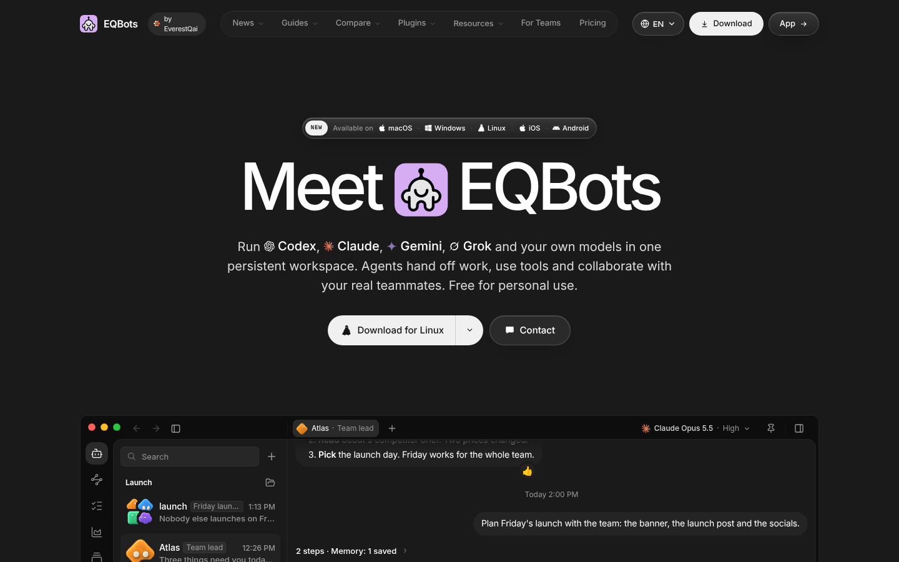

### 2. EQBots Web Workspace (`https://eqbot.everestqai.com/app-preview`)
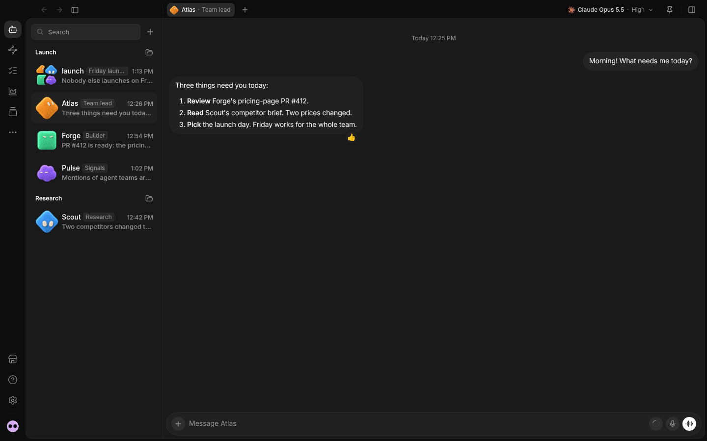

### 3. EQBots Account Sign-In (`https://eqbot.everestqai.com/app`)
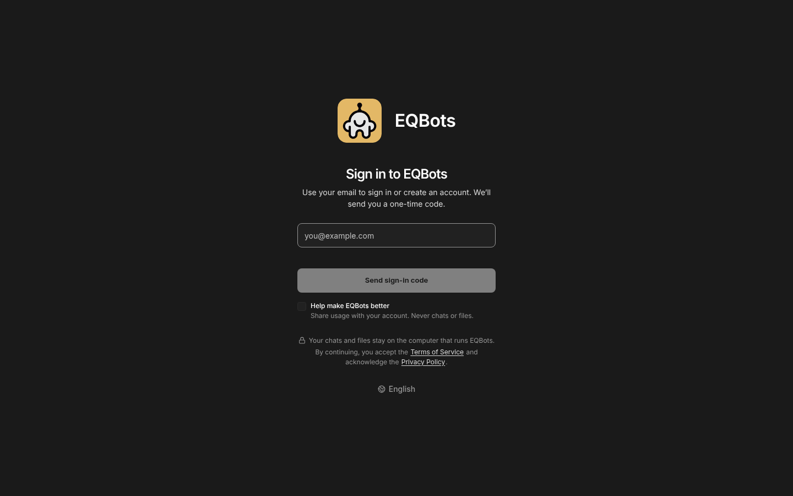

### 4. All-Platforms Download Hub (`https://eqbot.everestqai.com/download`)
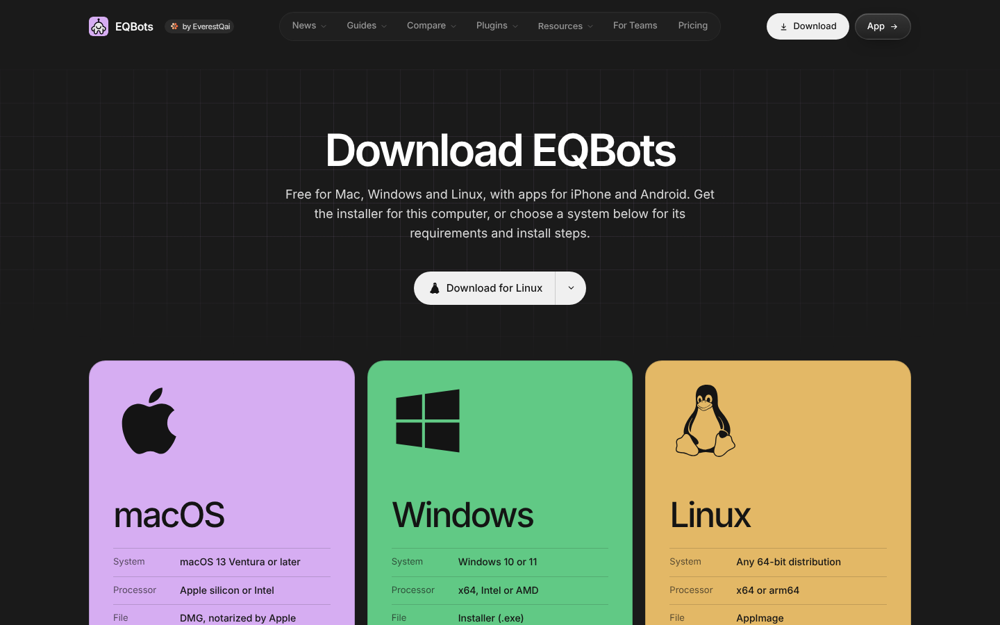

### 5. Platform Downloads (`macOS`, `Windows`, `Linux`, `iOS`, `Android`)

| macOS (`/download/macos`) | Windows (`/download/windows`) |
| :---: | :---: |
| 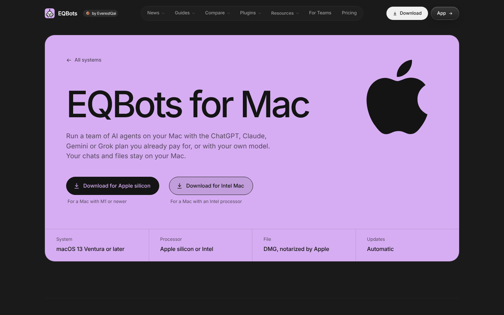 | 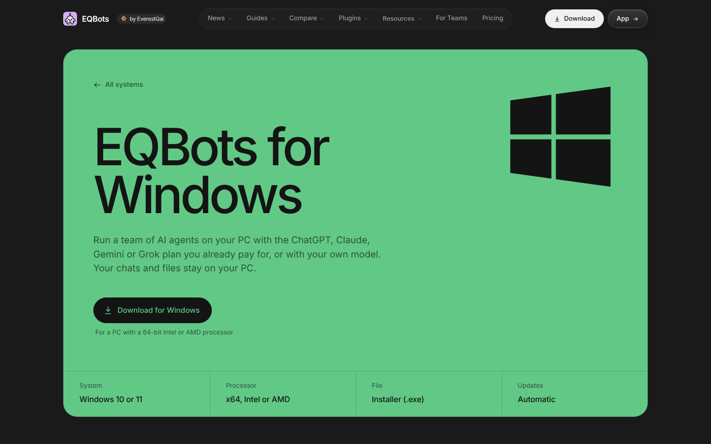 |

| Linux (`/download/linux`) | iOS (`/download/ios`) |
| :---: | :---: |
| 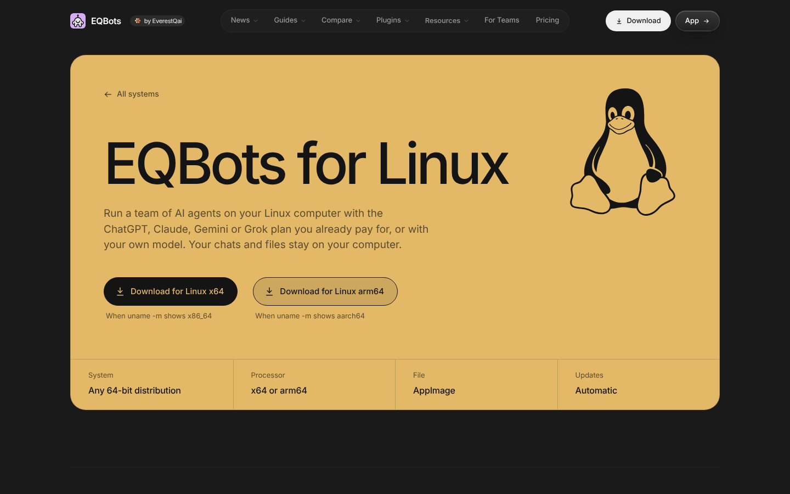 | 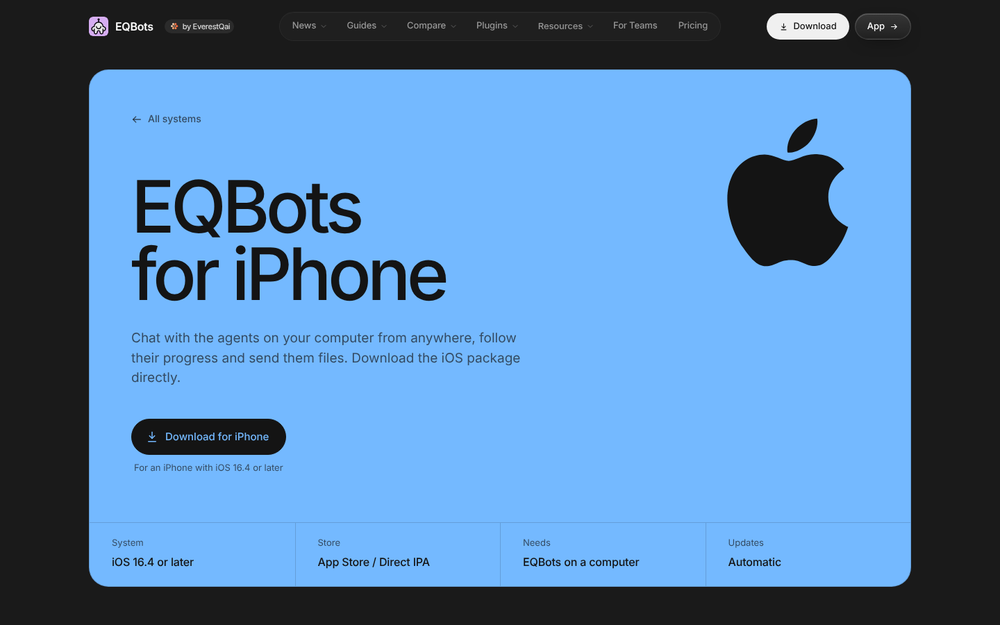 |

| Android (`/download/android`) | Brand & EverestQai Media Kit (`/brand`) |
| :---: | :---: |
| 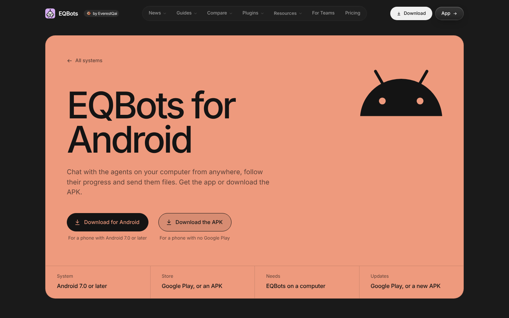 | 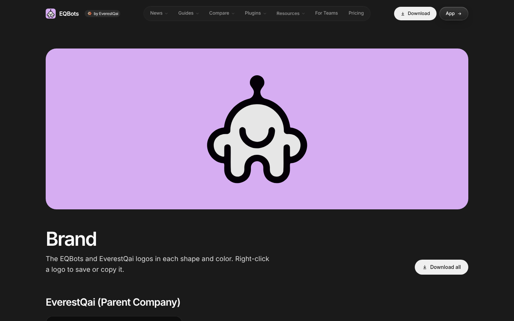 |

### 6. EQBots Marketplace (`https://eqbot.everestqai.com/marketplace`)
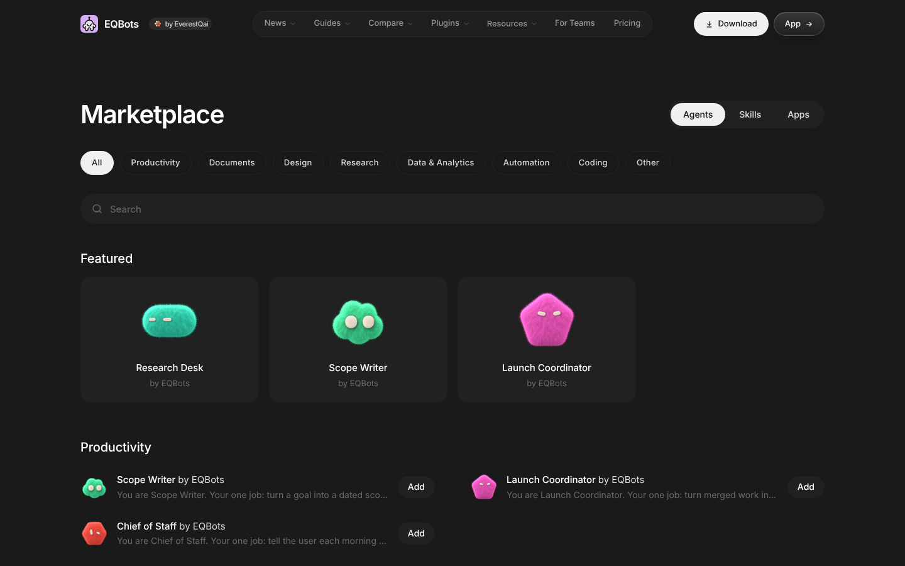

---

## What works

- Prompt-driven agent creation and editing on desktop, web, and mobile, with editable instructions, avatar, and section review before saving.
- Persistent agents backed by independent Codex, Claude, Grok, OpenCode, Gemini, Cursor, Cline, Kimi, Devin, GitHub Copilot, Mistral, or Hermes sessions and local workspaces.
- Custom OpenAI-compatible endpoints and custom ACP agents, with detection of local model servers (Ollama, LM Studio) and installed agents.
- Per-agent context monitoring with automatic compaction before long threads exhaust the model window.
- FIFO message queues with pause, resume, cancellation, and crash-safe persistence.
- Agent-to-agent messages, replies, reactions, images, and managed file transfers.
- Shared desktop channel chats with one task owner, explicit delegation, shared history, and Stop, Resume, Reassign, Archive, and Restore controls.
- A persistent embedded browser that agents can open, inspect, and control.
- Optional Computer Use on macOS, Windows and Linux through the `cua-driver` binary in the release, which EQBots starts as its own child process and gives to every provider.
- Per-agent model, reasoning, profile, notification, browser, and panel state.
- Local data and privacy-safe diagnostics exports from the account menu.
- Optional EQBots accounts through one-time email codes.

EQBots is local-first, not offline-only. Codex connects to OpenAI, Claude connects to Anthropic,
Grok connects to xAI, Gemini connects to Google, Cursor connects to Cursor, Cline connects to Cline,
Kimi connects to Moonshot AI, Devin connects to Cognition, GitHub Copilot connects to GitHub, Mistral connects to Mistral AI, Hermes connects to Nous Portal and to the providers you set up in Hermes,
visited pages use the network, and installed plugins may connect to their own services.

## Install & Download (`macOS`, `Windows`, `Linux`, `iOS`, `Android`)

EQBots supports **macOS 13+** (Apple silicon & Intel), **Windows 10+** (x64), **Linux** (x64 & arm64 AppImage), **iOS 16.4+** (iPhone / iPad), and **Android 7.0+** (Google Play & direct APK).

| Platform | Direct Installer Route | Package Filename |
| --- | --- | --- |
| **macOS (Apple Silicon)** | [`https://eqbot.everestqai.com/download/macos/latest`](https://eqbot.everestqai.com/download/macos/latest) | `EQBots-0.70.0-arm64.dmg` |
| **macOS (Intel)** | [`https://eqbot.everestqai.com/download/macos/latest?arch=x64`](https://eqbot.everestqai.com/download/macos/latest?arch=x64) | `EQBots-0.70.0-x64.dmg` |
| **Windows (x64)** | [`https://eqbot.everestqai.com/download/windows/latest`](https://eqbot.everestqai.com/download/windows/latest) | `EQBots-0.70.0-x64.exe` |
| **Linux (x86_64)** | [`https://eqbot.everestqai.com/download/linux/latest`](https://eqbot.everestqai.com/download/linux/latest) | `EQBots-0.70.0-x86_64.AppImage` |
| **Linux (ARM64)** | [`https://eqbot.everestqai.com/download/linux/latest?arch=arm64`](https://eqbot.everestqai.com/download/linux/latest?arch=arm64) | `EQBots-0.70.0-arm64.AppImage` |
| **iOS (iPhone / iPad)** | [`https://eqbot.everestqai.com/download/ios/latest`](https://eqbot.everestqai.com/download/ios/latest) | `EQBots-0.70.0-ios.ipa` |
| **Android (APK)** | [`https://eqbot.everestqai.com/download/android/latest`](https://eqbot.everestqai.com/download/android/latest) | `EQBots-0.70.0.apk` |

### macOS

1. Download the latest `EQBots-*-arm64.dmg` (or `EQBots-*-x64.dmg` on an Intel Mac) from [`https://eqbot.everestqai.com/download/macos`](https://eqbot.everestqai.com/download/macos) or [GitHub Releases](https://github.com/Rahulchaube1/eqbot/releases).
2. Drag EQBots to Applications and open it.

### Windows

1. Download the latest `EQBots-*-x64.exe` from [`https://eqbot.everestqai.com/download/windows`](https://eqbot.everestqai.com/download/windows) or [GitHub Releases](https://github.com/Rahulchaube1/eqbot/releases).
2. Run the installer and open EQBots.

### Linux

1. Download the latest `EQBots-*-x86_64.AppImage` (or `EQBots-*-arm64.AppImage` on arm64) from [`https://eqbot.everestqai.com/download/linux`](https://eqbot.everestqai.com/download/linux) or [GitHub Releases](https://github.com/Rahulchaube1/eqbot/releases).
2. Make it executable with `chmod +x EQBots-*.AppImage`, then run it.

The AppImage does not need libfuse2, so it also runs on Arch Linux and Omarchy. It mounts itself
with `fusermount3` from the `fuse3` package.

On Ubuntu 23.10 or newer and on Debian 13, unprivileged user namespaces are restricted by AppArmor
and EQBots exits during launch until you install an AppArmor profile:

```bash
sudo install -m 0644 build/linux/openbot.apparmor /etc/apparmor.d/openbot
sudo systemctl reload apparmor
```

### iOS (iPhone & iPad)

1. Open [`https://eqbot.everestqai.com/download/ios`](https://eqbot.everestqai.com/download/ios) or download `EQBots-0.70.0-ios.ipa` directly from [`/download/ios/latest`](https://eqbot.everestqai.com/download/ios/latest).
2. Sign in with the same EQBots account as your computer to chat with your agents from anywhere.

### Android

1. Open [`https://eqbot.everestqai.com/download/android`](https://eqbot.everestqai.com/download/android) or download `EQBots-0.70.0.apk` directly from [`/download/android/latest`](https://eqbot.everestqai.com/download/android/latest).
2. Open the APK on Android 7.0 or newer and sign in to connect to your computer's agents.

#### Theme palette files

EQBots reads each `<name>.json` file in the `themes` folder of its data folder
(`~/.config/OpenBot/themes/` on Linux) and lists it under Settings > General > Theme:

```json
{
  "name": "Omarchy",
  "appearance": "dark",
  "colors": {
    "canvas": "#1a1b26",
    "frame": "#13141c",
    "sidebar": "#13141c",
    "surface": "#24283b",
    "text": "#a9b1d6",
    "textMuted": "#565f89",
    "border": "#414868",
    "accent": "#7aa2f7",
    "accentForeground": "#1a1b26",
    "success": "#9ece6a",
    "warning": "#e0af68",
    "danger": "#f7768e"
  }
}
```

#### Linux server with no screen

To run EQBots as an always-on server of your account on a VPS or home server (Ubuntu 24.04 or
26.04 with systemd), install it from a terminal and sign in with an email code:

```bash
curl -fsSL https://raw.githubusercontent.com/Rahulchaube1/eqbot/main/scripts/install-server.sh | sudo bash
sudo openbot login
```

Then use it from the desktop app, the iPhone/Android app or `https://eqbot.everestqai.com/app`. See
[self-hosted servers](docs/self-hosted-server.md) for the options and the `openbot` commands.

#### Docker

The same server runs as a container (`linux/amd64` and `linux/arm64`). The seccomp profile lets the
Electron sandbox stay on:

```bash
curl -fsSLO https://raw.githubusercontent.com/Rahulchaube1/eqbot/main/docker/seccomp.json
docker run -d --name eqbots --restart unless-stopped \
  --security-opt seccomp=seccomp.json --security-opt no-new-privileges:true \
  --shm-size 1g --stop-timeout 60 -v openbot-data:/data \
  ghcr.io/rahulchaube1/eqbot:latest
docker exec -it eqbots openbot login
```

See [Docker](docs/docker.md) for Compose, the data volume, upgrades and the security limits. For Amazon ECS,
see [AWS ECS](docs/aws-ecs.md).

### Agent setup

EQBots can download a supported provider runtime when you select `Download` in onboarding,
Settings, agent setup, or the model picker. EQBots prefers its managed CLI. Explicit `OPENBOT_*_PATH` overrides take precedence; a compatible
system CLI is used when no managed copy is available.

Codex CLI on macOS:

```bash
curl -fsSL https://chatgpt.com/codex/install.sh | sh
```

Claude CLI on macOS:

```bash
curl -fsSL https://claude.ai/install.sh | bash
```

Install Grok CLI following the [Grok Build documentation](https://docs.x.ai/build/overview), then
authenticate with `grok login` or set `XAI_API_KEY` in the environment used to launch EQBots.

See [Gemini setup and download recovery](docs/architecture/providers.md#gemini) and [provider terms](docs/provider-terms.md). For setup problems, data reset, and uninstall instructions, see
[Troubleshooting](docs/TROUBLESHOOTING.md). EQBots's data and network behavior is documented in
[Privacy](PRIVACY.md).

## Development

Development requires stable [Bun](https://bun.sh/) 1.4.2, Node.js 24 (the version in `.nvmrc`, matching
the Node that Electron bundles - run `nvm use`), and at least one supported agent CLI.

Install the exact Bun version on macOS or Linux:

```bash
curl -fsSL https://bun.com/install | bash -s "bun-v1.4.2"
```

Clone and start EQBots:

```bash
git clone https://github.com/Rahulchaube1/eqbot.git
cd eqbot
bun install --frozen-lockfile
bun run dev:prepare
bun run dev
```

### Marketplace launch catalog

Seed the approved EQBots team catalog locally with `bun run marketplace:seed:local`, then start or reuse `bun run dev`. Search **EQBots** in Marketplace to review its Skills and Agents. See the [catalog and publication guide](marketplace/production-catalog/README.md).

## Local skills

Ask an agent to create a skill from a reusable workflow. It prepares a folder with `SKILL.md` and calls `create_skill`. The skill is saved in a shared local library and enabled for that agent. Other agents can add it through **Settings → Skills → Local skills**.

## Import agents from Grok Bot

Open **Server settings → Import** on this computer, or on a joined server in the desktop app or the browser client. Add the [EQBots export agent](https://x.ai/bot/pOUBH2kQK8CKvM7nW8stG) to Grok Bot and say "Export my agents for EQBots". It saves one `.zip` file to Downloads. Choose that file in EQBots, select the agents, and import them. The export skill and its format are in [`resources/agent-import/grok-bot/SKILL.md`](resources/agent-import/grok-bot/SKILL.md).

## Commands

The browser client is served at `/app` by the public web app (`https://eqbot.everestqai.com/app`). For local development, run
`bun run dev:api` and open `/app` on the API URL printed by the supervisor. Use
`bun run dev` when a desktop host is also needed.
See [web client delivery](docs/web-client.md) for the release gate and focused checks.

| Command | Purpose |
| --- | --- |
| `bun run dev` | Start the local Auth API, Signal service, and Electron client with renderer HMR on its app profile. See [docs/hosted-servers.md](docs/hosted-servers.md#real-servers-from-a-development-build). |
| `bun run preview` | Preview the built Electron client with the green preview icon. |
| `bun run mobile:go` | Start the mobile app in Expo Go and clear the Metro cache. |
| `bun mobile:ios` | Build and launch the iOS simulator app without RocketSim. |
| `bun run dev:mobile` | Start or reuse this worktree's `bun run dev` stack, build and launch the iOS simulator app, and pair them without a QR scan. |
| `bun run mobile:ios:build:local` | Build a production iOS `.ipa` locally for upload with Transporter. See [TestFlight setup](apps/mobile/README.md#local-testflight-build). |
| `bun run mobile:ios:release:testflight` | Start the GitHub Actions iOS build from `main` and upload to TestFlight. See [iOS release setup](apps/mobile/README.md#github-actions-testflight-release). |
| `bun mobile:ios:rocketsim` | Start RocketSim and build and launch the iOS simulator app with RocketSim Connect. See [mobile setup](apps/mobile/README.md#development). |
| `bun run mobile:go:tunnel` | Start the mobile app in Expo Go through a Metro tunnel and clear the cache. |
| `bun run dev:api` | Start the TanStack Start API and its local D1 database on `127.0.0.1:3100`. |
| `bun run dev:apns-key -- <AuthKey_ID.p8> [KEY_ID]` | Save an Apple Push Notification service key in ignored development state. |
| `bun run api:start` | Build and preview the Cloudflare Worker locally. |
| `bun run api:images` | Draw the article artwork into `apps/auth-api/content-art/`. |
| `bun run api:migrate:local` | Apply D1 migrations to the local development database. |
| `bun run api:migrate:remote` | Apply D1 migrations to the configured remote database. |
| `bun run api:deploy` | Build and deploy the account API. |
| `bun run api:stripe:bootstrap` | Create or update the Stripe plan catalog and Customer Portal settings. See [Billing](docs/architecture/servers.md#billing). |
| `bun run hosting:setup --target=production\|test` | Set up the Stripe catalog, the Customer Portal, and the Stripe and boat webhooks. See [hosted servers](docs/hosted-servers.md#production). |
| `bun run hosting:template` | Build the boat named snapshot that new hosted servers start from. See [hosted servers](docs/hosted-servers.md). |
| `bun run status:build` | Build the public status page in `apps/status/dist`. |
| `bun run status:smoke` | Run the status page smoke test. |
| `bun run remote:up` | Build and start the self-hosted Signal, coturn, and ACME stack. |
| `bun run remote:check` | Check the Remote API and both Docker Compose configurations. |
| `bun run remote:check:compose` | Validate both Docker Compose configurations alone, without a running daemon. |
| `bun run remote:update` | Update Signal, then drain and update the single coturn instance. |
| `bun run dev:all` | Start the Auth API, Signal service, and single local Electron instance. |
| `bun run dev:slack` | Start the same stack as `bun run dev`, with two `cloudflared` quick tunnels. See [docs/messaging.md](docs/messaging.md#test-slack-locally). |
| `bun run dev:test-client` | Start the Auth API, Signal service, local instance, and an isolated second client for team testing. |
| `bun run dev:seed` | Replace only the app development profile with durable showcase data. |
| `bun run dev:reset` | Delete the local app, test-client, and legacy host development state. |
| `bun run dev:status` | Print, as JSON, every dev stack and dev app instance live on this machine. |
| `bun run dev:verify` | Print a stable JSON verification plan for this worktree. |
| `bun run dev:restart-client` | Restart only the test client of this worktree's `dev:test-client` stack. |
| `bun run dev:stop` | Stop this worktree's dev stack, children included, using the pids in the registry. |
| `bun run dev:forget` | Drop this worktree's stack record without signalling anything. |
| `bun run storybook` | Start Storybook on a port allocated through the same registry. |
| `bun run build-storybook` | Build static Storybook. |
| `bun run dev:automation` | Drive the running dev app over CDP: `instances`, `pages`, `snapshot`, `screenshot`, `record`, `click`/`type`. |
| `bun run dev:cpu` | Measure idle CPU on the running dev app, per process kind and per page. |
| `bun run dev:memory` | Measure the running dev app's memory once. |
| `bun run dev:bench` | Run repeatable RAM and CPU scenarios on the built app. |
| `bun run perf:remote` | Measure how fast a remote client gets into the workspace. See [remote connect measurement](docs/architecture/servers.md#remote-connect-measurement). |
| `bun run check` | Run Biome, both typechecks, offline tests, the browser smoke test, and the production build. |
| `bun run typecheck` | Check all 15 projects in parallel. |
| `bun run knip:check` | Find unused files, exports, and types, unused or unlisted dependencies, and unresolved imports. |
| `bun run check:ui` | Check the renderer against the design system. |
| `bun run check:assets` | Verify tracked image or video files are inside allowed asset directories. |
| `bun run check:doc-links` | Verify links in tracked Markdown files. |
| `bun run verify:preload` | Verify the built preload with a fake Electron. |
| `bun run types:ratchet` | Hold each TypeScript option in `tools/typescript/type-baseline.json` to its error count per file. |
| `bun run i18n:check` | Check the translation catalogs across all 15 locales. See [docs/i18n.md](docs/i18n.md). |
| `bun run test:backend` | Run backend tests only. |
| `bun run test:changed` | Run only the desktop and mobile test files that import a file changed since `origin/main`. See [docs/development-checks.md](docs/development-checks.md#focused-tests). |
| `bun run test:related -- <source>...` | Run only the test files that import the named source files. |
| `bun run test:browser-agent-session` | Check isolated agent browser sessions and profiles. |
| `bun run test:browser-profile-agents` | Check stored browser profiles across restarts. |
| `bun run test:browser` | Run the complete local embedded-browser smoke test. |
| `bun run test:codex` | Probe the real CLI handshake and account without starting a paid turn. |
| `bun run test:durations` | Re-record how long each desktop test file takes. |
| `bun run cua-driver:doctor` | Print which `cua-driver` binary EQBots uses for Computer Use. |
| `bun run prepare:cua-driver` | Write the pinned Computer Use driver to `build/cua-driver/<platform>/<arch>`. |
| `bun run pin:cua-driver <version>` | Print a new `cuaDriver` block for `native-runtime.lock.json`. |
| `bun run package` | Build an unpacked local application for the architecture of this Mac. |
| `bun run package:verify` | Build and verify the real app bundle for this Mac. |
| `bun run package:win` | Build an unpacked local Windows x64 application on Windows. |
| `bun run package:win:verify` | Build and verify the Windows x64 application on Windows. |
| `bun run package:linux` | Build an unpacked local Linux x64 application on Linux. |
| `bun run package:linux:arm64` | Build an unpacked local Linux arm64 application on arm64 Linux. |
| `bun run package:linux:verify` | Build and verify the Linux x64 application on Linux. |
| `bun scripts/create-github-app.ts [--org <org>]` | Create the EQBots GitHub App from `scripts/github-app/manifest.json`. |
| `bun run release:preflight` | Verify version, Git state, and GitHub release secrets before tagging. |
| `bun run dist:mac` | Build unsigned local DMG and ZIP update artifacts for this Mac. |
| `bun run dist:win` | Build an unsigned Windows x64 NSIS installer on Windows. |
| `bun run dist:linux` | Build an unsigned Linux x64 AppImage on Linux. |
| `bun run dist:linux:arm64` | Build an unsigned Linux arm64 AppImage on arm64 Linux. |
| `bun run release:patch` | Create the next patch version commit and tag. |
| `bun run mobile:release` | Open the mobile release menu. |
| `bun run mobile:release:patch` | Move the iPhone app notes from `apps/mobile/changelog.d` into `apps/mobile/CHANGELOG.md`. |
| `bun run mobile:ota:check` | Show the native runtime version of this checkout and compatible mobile store builds. See [over-the-air updates](apps/mobile/README.md#over-the-air-updates). |
| `bun run mobile:ota:publish -- --platform <ios\|android\|all> --message <text>` | Start the `Mobile OTA update` workflow for the current branch. |
| `bun run mobile:release:ota -- --base <store build tag> --platform <ios\|android\|all>` | Move new note files into an over-the-air section of `apps/mobile/CHANGELOG.md`. |
| `bun run test:mobile-ota` | Run the mobile update server (`apps/mobile-updates`) E2E test on a local R2 bucket. |
| `bun run mobile:release:published <ios\|android\|both>` | Write today's date for a store that made the mobile build available. |
| `bun run test:acp-directories` | Run three fake ACP agents through the `acp` provider driver. |
| `bun run test:custom-agents` | Run two fake ACP agents through the agent store and `acp` provider router. |
| `bun run test:mcp-tool-consent` | Run the real Codex app-server with a fake model, a real MCP server and the real attention registry. |
| `bun run test:ui-blocks` | Run the real attention registry and Team API codecs on `ask_ui` blocks. |
| `bun run test:filesystem` | **Online/manual:** run real full-access Codex and Claude filesystem turns. |
| `bun run test:imagegen` | **Online/manual:** run a real full-access image-generation turn. |
| `bun run test:workspace-only` | **Online/manual:** run real Workspace only Codex, Claude, Grok and OpenCode turns. |
| `bun run test:provider-detection` | Run local detection, Load models and endpoint Edit against fake OpenAI-compatible servers. |
| `bun run test:storage-live` | **Online/manual:** verify isolated Codex and Claude turns in a temporary SQLite database. |

Production mobile analytics setup and required OpenPanel credentials are documented in
[EQBots Mobile](apps/mobile/README.md#openpanel-product-analytics).

### macOS remote desktop permissions

For each macOS account, log in to its GUI session and open **Server Settings → Remote desktop access**.
Select **Check again** to read Sunshine's Screen Recording and Accessibility permissions, display availability,
and GUI session status. See the [host deployment guide](docs/multi-tenant-hosting.md).

## Architecture

```text
Electron main
├── local Codex App Server process over stdio JSONL
├── local Claude Agent SDK session over stream JSON
├── SQLite command log and read projections
├── secure typed IPC handlers
└── sandboxed WebContentsView browser host
    ↕ typed preload bridge
SolidJS renderer

Cloudflare Workers / Web Host (eqbot.everestqai.com)
└── TanStack Start + Solid 2 account API & web client
    ├── D1 accounts, email challenges, hashed sessions, and team tunnels
    └── R2 account avatars
```

- `src/main` owns the Electron lifecycle, window security, local protocol, and IPC registration.
- `src/backend` owns provider adapters, persistence, message scheduling, transfers, and the browser host.
- `src/preload` exposes only the typed `window.openbot` API.
- `src/renderer` contains the SolidJS interface.
- `apps/auth-api` contains the TanStack Start account API, one-time email codes, rate limits, and D1 migrations. It also serves the public site (`https://eqbot.everestqai.com`): the landing page, `/download` (`macOS`, `Windows`, `Linux`, `iOS`, `Android`), `/news`, `/guides`, `/brand`, and the Marketplace pages at `/marketplace` (Agents, Skills, and Apps).
- `apps/status` contains the public status page and the script that sends the [status webhooks](docs/status-webhooks.md) of the team.
- `packages/contracts` contains process-boundary contracts, shared limits, and pure validation.
- `packages/i18n` contains the interface text in English and 14 other languages, Arabic and Hebrew with a right-to-left layout, for desktop, web and mobile. See [docs/i18n.md](docs/i18n.md) to add text or a language.

See [docs/ARCHITECTURE.md](docs/ARCHITECTURE.md) for dependency direction, state ownership, and
rules for new modules.

## Local data and network boundaries

- `~/OpenBot/Agents/<agent-id>` — one working directory per agent.
- `~/OpenBot/Shared` — files intentionally shared between agents.
- `~/OpenBot/Shared/Transfers` — managed message snapshots and generated files.
- `~/OpenBot/Downloads` — embedded-browser downloads.
- Electron `userData/openbot.db` — the canonical SQLite event log and projections for agents,
  conversations, provider session bindings, queues, reactions, and attachment indexes.

To run your own account service, Signal and TURN, see [Self-hosted remote access](docs/self-hosting.md).
To trigger routines from external services, see [Webhooks](docs/webhooks.md).

## Security

Read [SECURITY.md](SECURITY.md) before reporting a vulnerability. Do not put credentials, private
files, conversation contents, or sensitive diagnostics in a public issue.

## Releases

Release signing secrets and the complete procedure are documented in
[docs/RELEASING.md](docs/RELEASING.md).

## Contributing

See [CONTRIBUTING.md](CONTRIBUTING.md). Before we merge a contribution, each
author from outside the organization signs the [Contributor License Agreement](CLA.md), which
gives EverestQai a license to use the contribution. Community behavior is governed by the
[Code of Conduct](CODE_OF_CONDUCT.md).

## License and attribution

Copyright 2026 **EverestQai** ([everestqai.com](https://www.everestqai.com)).

Licensed under the [PolyForm Noncommercial License 1.0.0](LICENSE). You may use, modify, and
distribute the code for permitted noncommercial purposes. Commercial use requires a separate license
from EverestQai.
See [NOTICE](NOTICE) for attribution and third-party notices.
